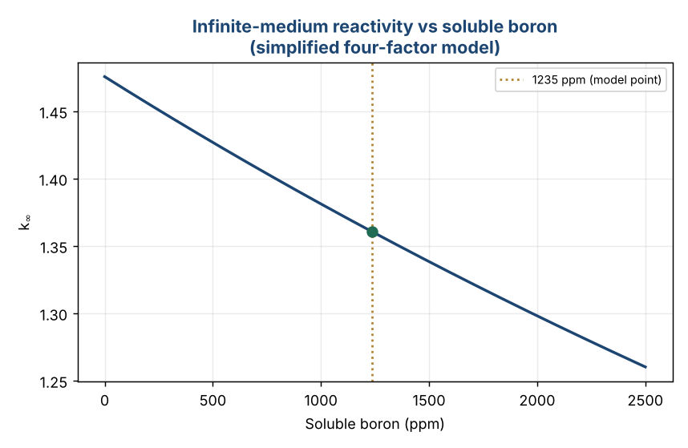

# SMR Neutronics — Monte Carlo Criticality (OpenMC)

Monte Carlo reactor-physics modelling of a small modular reactor (SMR) fuel
pin cell with **OpenMC**. This is the open, shareable version of the workflow I
used during my research internship on the **neutronic modelling of a
NuScale-type assembly** (supervised by Prof. Yahya Tayalati).

> In the internship, a full fuel assembly was modelled over **2.5 million active
> neutron histories**, giving k-effective = **1.00058 ± 0.00006**, cross-checked
> against a reference case (1.00137 ± 0.00054). The geometry here is a
> *representative* pin cell — the kind of model that can be published openly —
> running the same OpenMC criticality workflow.

---

## What it does

| File | Purpose |
|---|---|
| `pin_cell.py` | Full OpenMC model: UO₂ (4.05 wt%) pellet, He gap, Zircaloy clad, borated water (1235 ppm), square pitch, reflective boundaries; k-eigenvalue run + thermal-flux tally (0–0.625 eV). |
| `analytic_kinf.py` | Dependency-free four-factor cross-check: k∞ and boron reactivity worth, no nuclear-data library required. |

### The OpenMC model (`pin_cell.py`)
- **Materials** — enriched UO₂, helium, Zircaloy, borated light water with
  thermal scattering `S(α,β)` for hydrogen in water.
- **Geometry** — concentric cylinders (fuel / gap / clad) in a reflective square
  cell, i.e. an infinite lattice → computes the pin-cell **k∞**.
- **Settings** — eigenvalue mode, 150 batches (30 inactive), 20 000 particles
  (2.5 M+ active histories), Watt fission source.
- **Tally** — thermal flux below 0.625 eV, as in the assembly study.

### Runnable cross-check (`analytic_kinf.py`)
No data library needed — runs anywhere:



```
k_inf at    0 ppm boron = 1.476
k_inf at 1235 ppm boron = 1.361
differential boron worth ~ -4.6 pcm/ppm   (textbook PWR ~ -8 to -12 pcm/ppm)
```

This volume-homogenised four-factor estimate reproduces the right **trend** —
reactivity falls with soluble boron — and the right order of magnitude. It is a
teaching-level sanity check, deliberately simpler than the Monte Carlo transport
solution (constant resonance-escape and fast-fission factors, one thermal
group), and it under-predicts the boron worth for exactly those reasons.

---

## Run it

```bash
# Analytic cross-check — no data needed
pip install numpy matplotlib
python analytic_kinf.py

# Full Monte Carlo — needs OpenMC + a cross-section library
#   https://docs.openmc.org/en/stable/usersguide/install.html
#   export OPENMC_CROSS_SECTIONS=/path/to/cross_sections.xml
python pin_cell.py          # prints final k-effective; statepoint.150.h5
```

## Notes on scope & integrity
- The pin-cell geometry uses standard open PWR dimensions, **not** proprietary
  plant data.
- `k∞` of a single fresh pin cell is naturally > 1; the assembly k-effective of
  ≈ 1.0 comes from the full lattice, leakage and poisons in the complete model.

## Possible extensions
- Scale the pin cell to a full assembly lattice (`openmc.RectLattice`).
- Burnup / depletion with `openmc.deplete`.
- Temperature feedback (Doppler) via multiple cross-section temperatures.

---

**Author** — Wendlasida Rodrigue Kientega · Applied Physics Engineering, UM6P
License: MIT
